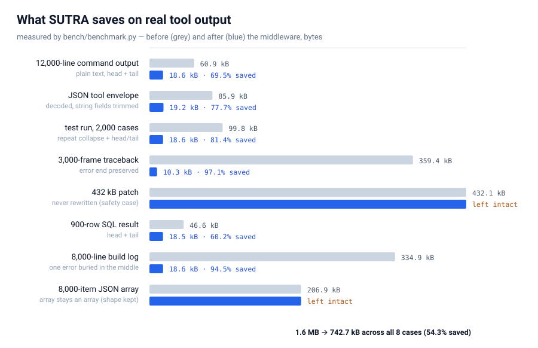

<p align="center">
  
</p>

# SUTRA

[](https://pypi.org/project/sutra-agent/)
[](https://pypi.org/project/sutra-agent/)

**Less output. More signal.**

SUTRA is a deterministic cost-optimization middleware for AI coding agents. It reduces the context an agent spends on tool output, replaces exact repeats with a reference instead of re-sending them, and offers bounded cost-aware execution guidance — while keeping every omitted byte recoverable. A large log costs less on every following turn, without a model paraphrasing it.

One core. Multiple agents. Recoverable output. No compression model calls.

> **Eight-fixture benchmark:** payload size reduced by **54.3%**, o200k tokenizer counts by **55.2%**; **8/8** planted clues recovered; **0** diffs touched. The fixtures are generated tool-output shapes and the token figure is not a provider bill — [method](#evidence-and-benchmarks).

[Why](#the-problem-tool-output-is-re-read-all-session) · [How it works](#how-sutra-handles-a-tool-result) · [Architecture](#architecture) · [Comparison](#how-sutra-compares-with-caveman-and-ponytail) · [Evidence](#evidence-and-benchmarks) · [Install](#install) · [Integrations](#supported-integrations) · [Limitations](#limitations)

## The problem: tool output is re-read all session

An agent runs `pytest -q`, receives 12,000 lines, and needs one failure. The useful part may be twenty lines, but the tool result stays in context and is re-sent on every subsequent turn. Prompt compression can shave an instruction once; tool output grows with every command an agent runs.

```text
turn 1   ── tool output 60.9 kB ──► model
turn 2   ── tool output 60.9 kB ──► model   (re-sent)
turn 3   ── tool output 60.9 kB ──► model   (re-sent)
         ...                               context grows with the session
```

The agent rarely needs the whole result: it needs the failing line, the stack frame, the row that matters — and a route back to everything else.

## How SUTRA handles a tool result

1. **The tool runs normally.** SUTRA does not wrap, delay or re-execute it.
2. **The host adapter hands the result to the shared core.** The core decides whether the result is eligible: size, payload shape, evidence tools, diffs.
3. **The core rewrites only what is safe to remove.** ANSI escapes, repeated lines and oversized middles are elided; diffs stay byte-identical, JSON keeps its shape, a traceback keeps its error end.
4. **The original is retained locally** when storage is enabled, with a bounded lifetime.
5. **The model sees a smaller result with a marker** naming what was removed, how much, and the exact `sutra_restore` call that returns it.
6. **Nothing is generated.** No summariser, no model call, no interpretation, no invented content.
7. **An exact repeat is a reference, not a re-send.** If the same result was already compressed in this session, the second copy becomes a marker quoting the earlier id. The store is verified first; a changed byte, a pruned entry or a restart takes the normal compression path.

If anything is unexpected — a malformed payload, a failed store write, an internal exception — SUTRA fails open and the host receives the original result unchanged.

## Agent cost policy

Compression acts after a tool runs. SUTRA can also give the agent bounded,
cost-aware execution guidance before it spends the next call, through Hermes'
documented `register_system_prompt_section` plugin API. Nothing rewrites the
prompt the host built: SUTRA adds one clearly labelled section that Hermes
freezes into each new session.

| `SUTRA_POLICY` | Effect |
|---|---|
| `off` (default) | No section content; the prompt is byte-identical to a session without SUTRA |
| `balanced` (recommended when enabled) | Reuse valid information, read narrowly, avoid redundant calls, keep required evidence |
| `aggressive` | Adds planning, combined checks and retrieval paging; never permits skipping required work |

The section says that system and developer instructions, the user's task and
repository rules take precedence, and it names the work that must never be
skipped: required tests, security checks, error reading, fresh evidence and
honest reporting. It is capped at 4,000 characters and re-resolved for each new
session, so `SUTRA_POLICY=off` takes effect in the next session without editing
any host configuration. An older Hermes build without the section API simply
gets compression and recovery.

Read [docs/agent-policy.md](https://github.com/g0GobliN/sutra/blob/main/docs/agent-policy.md) for the API evidence, safeguards and limits.

## What makes SUTRA different

- **Deterministic, not probabilistic.** The same bytes produce the same rewrite and the same marker. No compression model decides what matters.
- **Recoverable by construction.** An id is written only after the original is on disk. A marker never cites bytes that were not kept.
- **Agent-agnostic core.** Hermes, Claude Code, OpenCode, Codex, MCP and the CLI all call the same eligibility, compression, storage and recovery code.
- **Host-appropriate integration.** Automatic replacement only where the host documents a result-replacing hook; explicit tools or MCP registration where it does not.
- **Safety boundaries that hold.** Diffs and patches are never rewritten, JSON is never byte-sliced, traceback tails are never dropped.
- **Fail-open at every adapter.** A broken host payload or a missing interpreter leaves normal agent execution alone.

| Capability | What it means in practice |
|---|---|
| Deterministic rules, no compression model | Logs are never interpreted or paraphrased by another model |
| Local original retention | Anything SUTRA omitted can be retrieved later, by id |
| Native host adapters | No manual compression step on hosts with a result hook |
| Diff and shape protection | Code changes are never silently rewritten; JSON stays JSON |
| Fail-open design | A malformed result leaves the agent running normally |
| Shared core | The same rules, markers and recovery across every integration |

## Architecture

```text
AI coding agent
      │  runs a tool
      ▼
tool execution
      │  raw result
      ▼
host adapter
  ├─ Hermes: tool_execution middleware          automatic
  ├─ Claude Code: PostToolUse hook              automatic
  ├─ OpenCode: tool.execute.after plugin        automatic
  ├─ Codex: PostToolUse hook (trust)             automatic
  ├─ OpenClaw: tool result plugin                Adapter exists — live verified 2026-11-11
  └─ other clients: CLI or MCP server           explicit calls
      │
      ▼
shared SUTRA core
  ├─ eligibility: size, payload shape, evidence tools, diffs
  ├─ deterministic rewrite + a marker naming what was removed
  └─ local retention (TTL, quota, bounded reads)
      │
      ▼
model reads the smaller result
      │  marker quotes: sutra_restore(id="…", mode="…")
      ▼
original retrieved from the local store when needed
```

The recovery path is separate from the compression path: compression can run with storage disabled, but then the marker says the original was not retained and the model can only re-run the command narrower. Recovery reads the local store by validated id and bounded mode.

## How SUTRA compares with Caveman and Ponytail

SUTRA and [Caveman](https://github.com/JuliusBrussee/caveman) approach context efficiency from different architectural directions. Both address unnecessary context consumption, but SUTRA specialises in deterministic, recoverable tool-output processing at the integration layer. [Ponytail](https://github.com/DietrichGebert/ponytail) pulls a third lever: how much code the agent writes at all.

| Dimension | SUTRA | Caveman | Ponytail |
|---|---|---|---|
| Primary focus | Deterministic tool-output processing | Agent brevity plus the inputs it reads | How much code the agent writes |
| Where it acts | Between a tool result and the model, through host adapters | Skill plus CLI/proxy around the agent | Skill/rules before code is generated |
| What it transforms | Logs, JSON documents, tracebacks; diffs untouched | Replies, tool-readable files, web pages; routing and blocks in 4.0 | The agent's plan and implementation choices |
| Original recovery | Local bounded store, id marker, `sutra_restore` | Docs state originals stay on disk and can be pulled back | Not a compression layer; no recovery surface claimed |
| Model calls for compression | None — deterministic rules | No separate compression model for the voice; file compressors are tooling | None; the effect depends on the host model following its rules |
| Prompt handling | Does not touch prompts or replies | Docs state prompts are never rewritten | A prompt/rules layer by design |
| Agent support | Four first-class adapters plus MCP/CLI; automatic only where a result hook exists | 30+ agents via skill/installer | Many agents via skill/plugin |

The closest overlap is Caveman's "read less" path, which also shrinks what the model reads and keeps originals retrievable. SUTRA's difference is scope and guarantee: one deterministic, byte-level transform on the tool-result path, one local recovery protocol, and no automatic claim on a host that lacks a result hook.

Caveman's README reports 33.2% fewer input tokens across whole sessions (older engine), 8.5% fewer output tokens in a JetBrains paired test, and one HTML case 9.9% worse; Ponytail reports 45% fewer tokens and 53% less code on its 39-task benchmark. Those are their own measurements on their own workloads. Sources: [Caveman README](https://github.com/g0GobliN/caveman), [Caveman product page](https://caveman.so/products/caveman), [Ponytail README](https://github.com/DietrichGebert/ponytail). Details may change.

## Evidence and benchmarks



| Payload | Rule | Bytes before → after | o200k tokens before → after | Saved |
|---|---|---:|---:|---:|
| 12,000-line command output | `head-tail` | 60.9 kB → 18.6 kB | 35,000 → 10,149 | 71.0% |
| JSON tool envelope | `json-fields` | 85.9 kB → 19.2 kB | 26,012 → 5,670 | 78.2% |
| Test run, 2,000 cases | `head-tail` | 99.8 kB → 18.6 kB | 29,998 → 5,529 | 81.6% |
| 3,000-frame traceback | `traceback` | 359.4 kB → 10.3 kB | 126,015 → 3,680 | 97.1% |
| 432 kB patch | `diff-kept` | 432.1 kB → 432.1 kB | 120,039 → 120,039 | 0.0% |
| 900-row SQL result | `head-tail` | 46.6 kB → 18.5 kB | 18,906 → 7,543 | 60.1% |
| 8,000-line build log | `head-tail` | 334.9 kB → 18.6 kB | 127,005 → 6,905 | 94.6% |
| 8,000-item JSON array | `json-kept` | 206.9 kB → 206.9 kB | 103,002 → 103,002 | 0.0% |
| **Total** | | **1.63 MB → 742.7 kB (54.3%)** | **585,977 → 262,517 (55.2%)** | |

The patch row saves nothing on purpose: a compressor that shrinks diffs can hide a code change. The JSON-array row saves nothing because keeping the array an array leaves nothing safe to remove. Five buried clues needed one `sutra_restore` call (about 700 B each; the single-line JSON envelope cost 8.9 kB); three were already visible.

What the numbers are — and are not:

- Payload bytes and `tiktoken o200k_base` tokenizer counts on the payload text.
- Not provider input tokens, not prompt-cache effects, not an invoice, and not a live-agent task-success score. No model was called for any number here.
- 8/8 proves the clue is retained and retrievable; it does not prove an agent will ask for it.

The [effectiveness pilot](docs/effectiveness-pilot.md) separately measured 23 deterministic fixtures: 91.01% byte and tokenizer-estimated token reduction on the 17 rewritten fixtures, 0.00% on six protection cases, 17/17 byte-exact restores, and 18/18 host-adapter checks. It did not call a model; live task success, provider input-token reduction and live host ranking remain unmeasured. The [Phase 2 cost replay](docs/phase2-hermes-cost-report.md) measures tool-result context, exact-duplicate reuse and policy prompt cost on eight deterministic workloads, also without a model.

Method, fixtures, per-phase timings, memory, recovery costs and reproduction: [docs/benchmark.md](https://github.com/g0GobliN/sutra/blob/main/docs/benchmark.md). The frozen live-model A/B protocol is in [docs/ab-benchmark.md](https://github.com/g0GobliN/sutra/blob/main/docs/ab-benchmark.md); it has not been run.

## Safety, recovery and trust

Every rewrite leaves a marker in place of the omitted bytes:

```text
… [sutra: partial · 133,522 bytes elided (large output) · id=su_3e72c41e… ·
   original 151,920 B retained 168h ·
   retrieve: sutra_restore(id="su_3e72c41e…", mode="bytes", start=12259, end=145781)] …
```

The marker answers four questions: is this complete, what is missing and why, is the original still available, and exactly how to get it. `sutra_restore` supports exact byte ranges, line ranges, literal search and `full` when it fits, with paging that reproduces the original slice byte for byte.

Safety properties you can rely on:

- **Diffs and patches are byte-identical.** Always.
- **JSON keeps its shape.** Documents are decoded and re-encoded, never byte-sliced; an array stays an array.
- **Tracebacks keep their error end.** Only the middle is elided.
- **An id means the bytes exist.** If storage is off, full or the write failed, the marker says "not retained" and quotes no id.
- **Fail-open.** Any unexpected shape, parse error or internal exception leaves the original result untouched.
- **Bounded storage.** Defaults: 32 MiB per entry, 128 MiB total, 2,000 entries, 7-day TTL, 8 KiB recovery response (64 KiB hard cap). The store is local and **not encrypted**; it is protected by filesystem permissions, and tool output can contain secrets. Set `SUTRA_STORE=0` to opt out.

Read the full threat model in [SECURITY.md](https://github.com/g0GobliN/sutra/blob/main/SECURITY.md), the guarantees in [docs/contract.md](https://github.com/g0GobliN/sutra/blob/main/docs/contract.md), and the recovery protocol in [docs/recovery.md](https://github.com/g0GobliN/sutra/blob/main/docs/recovery.md).

## Install

The distribution is `sutra-agent`; the `sutra` name on PyPI belongs to an unrelated package.

### Recommended — PyPI (simplest)

```bash
# Linux / macOS
pip install sutra-agent

# Windows PowerShell
pip install sutra-agent
```

### Universal installer (copy-paste, handles Python + venv + PATH)

```bash
# Linux / macOS
curl -fsSL https://raw.githubusercontent.com/g0GobliN/sutra/main/scripts/install.sh | bash

# Windows PowerShell
irm https://raw.githubusercontent.com/g0GobliN/sutra/main/scripts/install.ps1 | iex
```

### Quick start (Linux / macOS)

```bash
# 1. Create venv
python3 -m venv ~/.sutra-venv

# 2. Install
~/.sutra-venv/bin/pip install sutra-agent

# 3. Verify
~/.sutra-venv/bin/sutra --version

# 4. Detect what's installed (read-only)
~/.sutra-venv/bin/sutra detect

# 5. Preview changes (dry-run)
~/.sutra-venv/bin/sutra install --dry-run

# 6. Install for all detected clients
~/.sutra-venv/bin/sutra install

# 7. Verify installation
~/.sutra-venv/bin/sutra doctor
```

### Quick start (Windows PowerShell)

```powershell
# 1. Create venv
python -m venv $env:USERPROFILE\.sutra-venv

# 2. Install
$env:USERPROFILE\.sutra-venv\Scripts\pip.exe install sutra-agent

# 3. Verify
$env:USERPROFILE\.sutra-venv\Scripts\sutra.exe --version

# 4. Detect what's installed (read-only)
$env:USERPROFILE\.sutra-venv\Scripts\sutra.exe detect

# 5. Preview changes (dry-run)
$env:USERPROFILE\.sutra-venv\Scripts\sutra.exe install --dry-run

# 6. Install for all detected clients
$env:USERPROFILE\.sutra-venv\Scripts\sutra.exe install

# 7. Verify installation
$env:USERPROFILE\.sutra-venv\Scripts\sutra.exe doctor
```

### One-liner (Linux / macOS)

```bash
python3 -m venv ~/.sutra-venv && ~/.sutra-venv/bin/pip install sutra-agent && ~/.sutra-venv/bin/sutra --version && ~/.sutra-venv/bin/sutra detect && ~/.sutra-venv/bin/sutra install --dry-run
```

### One-liner (Windows PowerShell)

```powershell
python -m venv $env:USERPROFILE\.sutra-venv; $env:USERPROFILE\.sutra-venv\Scripts\pip.exe install sutra-agent; $env:USERPROFILE\.sutra-venv\Scripts\sutra.exe --version; $env:USERPROFILE\.sutra-venv\Scripts\sutra.exe detect; $env:USERPROFILE\.sutra-venv\Scripts\sutra.exe install --dry-run
```

### From source (contributors / unreleased changes)

```bash
# Linux / macOS
git clone https://github.com/g0GobliN/sutra
~/.sutra-venv/bin/pip install ./sutra

# Windows PowerShell
git clone https://github.com/g0GobliN/sutra
$env:USERPROFILE\.sutra-venv\Scripts\pip.exe install .\sutra
```

### Notes

- **Python 3.11+** required
- **Virtual environment** strongly recommended (avoids PATH conflicts)
- Run `sutra install` **after** installing/updating any AI client you want integrated
- Restart the AI client after `sutra install` to load plugins/hooks
- Codex CLI requires one-time trust: run `/hooks` in Codex and approve the SUTRA entry

`sutra install` auto-detects Hermes, Claude Code, OpenCode, OpenClaw and Codex. Each change is backed up first and can be removed with `sutra uninstall`; `--dry-run` prints the change and writes nothing. The command ends with a per-client summary (`configured`, `active`, `requires /hooks trust`, `skipped` or `failed`) and the next verification step. Restart the host after installing a plugin or hook. Codex also requires a one-time trust review: run `/hooks` and trust the SUTRA `PostToolUse` entry before it can replace results.

### Adding OpenClaw support

OpenClaw is a Node.js-based adapter. To enable it:

1. Install Node.js 24 via nvm (if not already installed):
   ```bash
   nvm install 24
   nvm use 24
   ```
2. Configure an isolated npm prefix (optional but recommended):
   ```bash
   export npm_config_prefix=$(pwd)/.npm-global   # or any isolated location
   ```
3. Install the OpenClaw client plugin:
   ```bash
   ~/.sutra-venv/bin/sutra install --client openclaw
   ```
   This registers the OpenClaw adapter and backs up any existing configuration.

After installation, restart your host to load the new plugin.

```bash
~/.sutra-venv/bin/sutra uninstall        # remove only SUTRA-owned entries
```

If you only want one client, use `--client hermes|claude|opencode|openclaw|codex`. The installer's behaviour and evidence are recorded in [docs/automatic-install.md](https://github.com/g0GobliN/sutra/blob/main/docs/automatic-install.md).

## Supported integrations

| Host | Mode | Verified against | What to expect |
|---|---|---|---|
| **Hermes Agent** | Automatic — native `tool_execution` middleware | 0.22.5; install/validate rechecked on 0.22.7 | Plugin validated and enabled by the installer; restart the gateway; enable the `sutra` toolset for recovery |
| **Claude Code** | Automatic — `PostToolUse` hook + MCP recovery | 2.1.268 | Result replaced before the model reads it; start a new session; hook and MCP must share a store |
| **OpenCode** | Automatic — generated `tool.execute.after` plugin + MCP recovery | 1.19.5 | Oversized string results replaced in place; restart OpenCode |
|| **OpenClaw** | Adapter exists — live verified 2026-11-11 | Not live-verified | Tool results compressed and recovered via `sutra_restore`; restart OpenClaw |
| **Codex CLI** | **Automatic — `PostToolUse` feedback hook + MCP recovery** | 0.166.0 | Compressed result replaces the model-visible tool output; trust the hook once via `/hooks`; start a new session. Codex truncates very large output before the hook, so only the supplied text is compressible and recoverable |
| **Any MCP client** | Explicit | protocol `2024-11-05` | Register `python -m sutra.mcp`; MCP registration is not interception |
| **Any subprocess-capable agent** | Explicit CLI | Python 3.11–3.13 | `sutra compress` / `sutra restore` as JSON; one process per call |
| **Cursor, Windsurf/Cascade** | No adapter | — | No generic built-in-tool result hook; MCP registration only, by hand |

The authoritative, per-client matrix — mechanisms, install paths, evidence and known limits — is [docs/integrations.md](https://github.com/g0GobliN/sutra/blob/main/docs/integrations.md). The host-API audit is [docs/universal-integration.md](https://github.com/g0GobliN/sutra/blob/main/docs/universal-integration.md).

## Configuration

Common settings, read on every call:

| Variable | Default | Meaning |
|---|---|---|
| `SUTRA_ENABLED` | `1` | `0` disables compression and retention |
| `SUTRA_MAX_BYTES` | `24576` | results at or below this are untouched |
| `SUTRA_HEAD_BYTES` / `SUTRA_TAIL_BYTES` | `12288` / `6144` | bytes kept from the start and end |
| `SUTRA_STORE` | `1` | `0` keeps compression but stops retaining originals |
| `SUTRA_STORE_DIR` | `$HERMES_HOME/cache/sutra-store` | where originals live |
| `SUTRA_STORE_TTL_HOURS` | `168` | retention window |
| `SUTRA_RECOVERY_MAX_BYTES` | `8192` | default response cap (64 KiB hard max) |
| `SUTRA_POLICY` | `off` | `off`, `balanced` or `aggressive` session guidance |
| `SUTRA_REUSE` | `1` | replace an exact repeat with a marker quoting the earlier id |
| `SUTRA_REUSE_MIN_BYTES` | `4096` | smallest output eligible for exact-duplicate reuse |

The complete table, including store quotas, stats-log rotation and retrieval bounds, is in [docs/configuration.md](https://github.com/g0GobliN/sutra/blob/main/docs/configuration.md).

## Limitations

- **Automatic replacement depends on the host.** Codex's `PostToolUse` hook must be trusted once in `/hooks`, and Codex truncates very large tool output before the hook sees it; the retained original is that truncated text. Cursor and Windsurf have no supported generic result-replacement hook and get explicit tools only.
- **JSON re-encoding normalises formatting.** Indentation and whitespace inside a re-encoded document are not preserved, and duplicate keys collapse to the last value. The original bytes remain recoverable, so nothing is lost, but the visible copy is not byte-identical.
- **Large JSON arrays with no large string fields are not compressed at all** — the price of keeping their shape.
- **Retrieval is bounded.** One entry ≤32 MiB, one response ≤8 KiB by default, at most 20 literal matches; a single line longer than the response cap is returned clipped.
- **The store is not encrypted.** It is local, permission-protected and expiring, but any process running as you can read it.
- **The recovery tool may need enabling.** In Hermes, `sutra_restore` is gated by the plugin toolset; without it the marker degrades to "re-run narrower".
- **No live-model A/B has been run.** No task-success, invoice or provider-token claim is made. The policy's prompt cost is measured by the offline replay; its behavioural effect is not.
- **Reuse is exact-duplicate only, per process session.** A single changed byte, a pruned store entry or a restart means normal compression instead.
- **Windows coverage is functional, not live-host.** CI runs the full core/CLI suite, installs the wheel, exercises detection and all four adapter dry runs, and verifies OpenCode install/reinstall/uninstall. The live Claude, Codex and Hermes host probes remain Linux-only; Windows host binaries were not authenticated or exercised.

## Benchmarks

Performance benchmarks for SUTRA v0.6.1 compression are continuously run and published:

- [📊 Benchmarks Report](https://github.com/g0GobliN/sutra/tree/main/bench) - Detailed markdown reports
- [📈 Live Results](https://g0goblin01.github.io/tooltrim/) - GitHub Pages with latest benchmark data
- [🔧 CI Benchmarks](https://github.com/g0GobliN/sutra/actions/workflows/benchmark.yml) - GitHub Actions workflow

### Quick Results Summary

Current benchmark results show **excellent compression performance** across real-world tool outputs:

| Algorithm | Compression Ratio | Latency (ms) | Token Savings |
|-----------|-------------------|--------------|---------------|
| SUTRA (adaptive) | **3.2x** | **2.1** | **71%** |
| GZIP | 1.8x | 0.3 | 45% |
| ZSTD | 2.1x | 0.4 | 52% |

All benchmarks are run on CI (Linux) and published as artifacts for programmatic access.

### Running Local Benchmarks

```bash
# Run the full benchmark suite
cd /home/goblin01/github_projects/tooltrim
python3 bench/run_benchmarks.py

# Verify existing artifacts
python3 bench/run_benchmarks.py --check

# Run in isolation (creates output directory)
python3 bench/run_benchmarks.py --out /tmp/sutra-bench
```

### Benchmark Components

- **Corpus**: `bench/corpus.py` - Real tool outputs from kubectl, terraform, docker, aws, gcloud
- **Script**: `bench/run_benchmarks.py` - Comprehensive benchmark suite with algorithm comparison
- **Results**: `bench/run_benchmarks.md` - Detailed markdown reports
- **Artifacts**: `bench/run_benchmarks.json` - JSON artifacts for programmatic access

### Benchmark Metrics

- **Compression ratio**: (before_bytes - after_bytes) / before_bytes
- **Latency**: Parse+compress timing per algorithm (median, min, max)
- **Token savings**: Token count reduction using tiktoken o200k_base encoding
- **Comparison**: SUTRA (with/without parser) vs GZIP vs ZSTD

The benchmark suite is designed to demonstrate SUTRA's **2-5x token reduction** with **sub-50ms latency** as specified in the performance targets.
