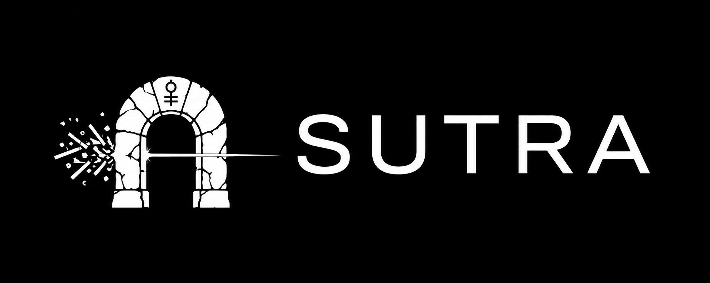

<p align="center">
  
</p>

# SUTRA

**Less output. More signal.**

SUTRA reduces the tool output your agent carries through a session. It keeps the original locally and gives the agent a way to retrieve omitted evidence when needed.

It runs as a [Hermes Agent](https://hermes-agent.nousresearch.com) plugin, or as a package whose MCP server any MCP client can register, and cuts tool output before the model reads it — your agent does not need the whole 2 MB log, it needs the failing line, the stack frame, the row that matters, and a way back to everything else. A tool result is read once and re-sent on every following turn, so a 2 MB log is 2 MB times the rest of the session (on one measured seven-agent fleet, 96.8% of all tokens were cache-reads of prior context). SUTRA attacks that, deterministically, with no model calls — and keeps every original, because a compressor that cannot be questioned is a compressor you cannot trust.

> **54.3%** fewer bytes · **55.2%** fewer o200k tokens · **8/8** planted clues recovered · **0** diffs touched
>
> Eight generated tool-output shapes. The token column is `tiktoken o200k_base` on the payload text, not a provider bill. [Method and limits](#proof-not-a-promise).

[Install](#install) · [How it works](#how-it-works) · [Proof](#proof-not-a-promise) · [Recovery](#how-recovery-works) · [What we don't claim](#what-we-dont-claim)

## Install

Two ways in: as a Hermes plugin, or as a Python package whose MCP server any MCP client can call. Both run the same deterministic core.

Automatic replacement is host-dependent. Hermes gets it natively; Claude Code gets it with its `PostToolUse` hook; MCP registration alone and the CLI are manual, because MCP has no server-side interception of another server's result. The matrix and the hook setup are in [docs/integrations.md](docs/integrations.md).

### Hermes Agent

```bash
git clone https://github.com/g0GobliN/sutra ~/.hermes/plugins/sutra
hermes plugins enable sutra
hermes tools        # enable the SUTRA plugin toolset
```

Compression does not depend on the toolset. The recovery tool is gated by toolset like any other Hermes tool: if you skip `hermes tools`, the marker's `sutra_restore` call fails and the model falls back to re-running the tool. The marker says so.

### Any MCP client

SUTRA is not on PyPI yet (the `sutra` name there belongs to an unrelated package; the distribution is `sutra-agent`), so install from a checkout:

```bash
git clone https://github.com/g0GobliN/sutra
python3 -m venv ~/.sutra-venv
~/.sutra-venv/bin/pip install ./sutra
~/.sutra-venv/bin/sutra --version    # sutra 0.2.0

# show the config edit, then make it; a .bak is written beside the file
~/.sutra-venv/bin/sutra install --dry-run
~/.sutra-venv/bin/sutra install
```

`sutra install` edits the config as text, so comments and every existing server survive; it writes a timestamped backup first, does nothing on a second run, and `sutra uninstall` restores the file byte for byte — including whether the `mcp` block ended with a trailing comma before the install. Restart OpenCode; `opencode mcp list` reports `sutra` connected (verified with OpenCode 1.19.0), and Claude Code 2.1.268 reports `✔ Connected` for the same server command.

Today the installer targets OpenCode; other MCP clients register the server themselves. The matrix in [docs/integrations.md](docs/integrations.md) states what has and has not been exercised per client.

For any other MCP client, register the same server yourself:

```json
{"mcpServers": {"sutra": {"command": "/home/you/.sutra-venv/bin/python",
                          "args": ["-m", "sutra.mcp"]}}}
```

### Claude Code (automatic)

The hook replaces a tool result before the model reads it. An install ships it
as the `sutra-hook` command; a checkout can run the script directly. Add one of
them to project or user settings with an absolute path, and register the MCP
server for recovery:

```json
{
  "hooks": {
    "PostToolUse": [
      {"hooks": [{"type": "command",
                  "command": "/home/you/.sutra-venv/bin/sutra-hook"}]}
    ]
  },
  "mcpServers": {"sutra": {"command": "/home/you/.sutra-venv/bin/python",
                          "args": ["-m", "sutra.mcp"]}}
}
```

From a checkout, use `python3 /path/to/sutra/scripts/sutra-claude-code-hook.py`
and the script path for the server instead; both commands run the same files.
The hook command must be absolute.

Both must use the same store: set `SUTRA_STORE_DIR` (or `HERMES_HOME`) in both
environments, or `sutra_restore` answers `not_found` for a marker the hook
wrote. The hook is fail-open — a parse, import or internal error prints `{}`
and leaves the original result untouched. This is hook-protocol tested; no live
authenticated Claude Code session was run here.

### Verify the Hermes plugin

Three states, three checks:

```bash
hermes plugins show sutra     # plugin:      Status: enabled, version 0.2.0
hermes plugins validate ~/.hermes/plugins/sutra   # loads it the way Hermes does
hermes tools list             # toolset:     "sutra  ✓ enabled" under Plugin toolsets
```

The middleware is active the moment the plugin is enabled — run any tool whose output exceeds `SUTRA_MAX_BYTES` (24,576 B by default) and the result the model sees carries a `[sutra: …]` marker. The recovery tool needs the toolset enabled ([troubleshooting](docs/troubleshooting.md) covers the Tool Search deferral case).

Current release: [v0.2.0](https://github.com/g0GobliN/sutra/releases/tag/v0.2.0). Verified against Hermes Agent `v0.22.2+3030.g4d04303`.

## How it works


The tool executes normally. SUTRA sees the result, applies one ordered set of rules, and hands the model a smaller result with a receipt:

| Rule | Applies to | Effect |
|---|---|---|
| ANSI strip | any result | removes colour/control escapes |
| Repeat collapse | runs of identical lines | keeps 2, replaces the rest with `[sutra: N identical line(s) omitted · id=…]` |
| Head+tail elision | plain text results over `SUTRA_MAX_BYTES` | keeps the start and the end, inserts an explicit marker with the byte count, the id, and the exact offsets |
| JSON field elision | a payload that *is* a JSON document | decodes it, runs the same rules on its string fields, re-encodes — never byte-sliced, never reshaped |
| Traceback preservation | a payload containing a traceback | keeps the error end and elides only the middle |
| Diff protection | diffs and patches | returned **byte-identical**, always |

The guarantees, stated once:

- **It only removes.** No summarising, no model calls, no rewriting, no invented content.
- **It always says what it removed** — byte counts and item counts, in a marker the model can read and act on.
- **It never touches diffs**, and never drops the tail of a traceback.
- **It never breaks a payload's own format.** JSON in, same-shaped valid JSON out — byte 12,288 of a serialized document can land inside an escape, so documents are decoded and re-encoded rather than cut.
- **It only cites bytes it actually kept.** No id, no promise.
- **It fails open.** Any unexpected shape, any parse error, any internal exception returns the original result untouched.

## Proof, not a promise


| payload | rule | bytes before → after | o200k tokens before → after | saved |
|---|---|---:|---:|---:|
| 12,000-line command output | `head-tail` | 60.9 kB → 18.6 kB | 35,000 → 10,149 | 71.0% |
| JSON tool envelope | `json-fields` | 85.9 kB → 19.2 kB | 26,012 → 5,670 | 78.2% |
| test run, 2,000 cases | `head-tail` | 99.8 kB → 18.6 kB | 29,998 → 5,529 | 81.6% |
| 3,000-frame traceback | `traceback` | 359.4 kB → 10.3 kB | 126,015 → 3,680 | 97.1% |
| 600 KB patch | `diff-kept` | 432.1 kB → 432.1 kB | 120,039 → 120,039 | 0.0% |
| 900-row SQL result | `head-tail` | 46.6 kB → 18.5 kB | 18,906 → 7,543 | 60.1% |
| 8,000-line build log | `head-tail` | 334.9 kB → 18.6 kB | 127,005 → 6,905 | 94.6% |
| 8,000-item JSON array | `json-kept` | 206.9 kB → 206.9 kB | 103,002 → 103,002 | 0.0% |
| **total** | | **1.63 MB → 742.7 kB (54.3%)** | **585,977 → 262,517 (55.2%)** | |

The patch row is the one to read twice. A compressor that also shrinks your diffs is a compressor that can hide a code change, so that row saves nothing on purpose. The JSON array row saves nothing because keeping the array an array leaves nothing safe to remove. And every buried clue came back: five fixtures needed one `sutra_restore` call (≈700 B each; the single-line JSON envelope cost 8.9 kB), three were already visible. The bytes and the tokens agree closely here — but they are different measurements, and neither is a line on your provider's bill; [What we don't claim](#what-we-dont-claim) has the boundary.

Per-fixture recovery costs, processing timings, peak allocation, methodology and one-command reproduction: [docs/benchmark.md](docs/benchmark.md). **No live model was called to produce any number in this repository.**

Savings on your own machine, from the plugin's own log:

```bash
python3 - <<'PY'
import json, pathlib
p = pathlib.Path.home() / ".hermes/cache/sutra-stats.jsonl"
rows = [json.loads(l) for l in p.read_text().splitlines() if l.strip()]
changed = [r for r in rows if r.get("changed", True)]  # older logs have rewrites only
before = sum(r["original_bytes"] for r in changed)
after = sum(r["compressed_bytes"] for r in changed)
stored = sum(1 for r in changed if r.get("stored"))
print(f"{len(changed)} rewrites, {before:,} → {after:,} bytes ({1 - after / before:.1%} saved), {stored} recoverable")
PY
```

The honest test is a before/after on your own workload: run the same task with the plugin disabled and enabled and compare `input_tokens` in the session row.

## How recovery works

Every rewrite leaves a single-line marker in place of the omitted bytes. A top-level elision looks like this (one line, wrapping here for width):

```
… [sutra: partial · 133,522 bytes elided (large output) · id=su_3e72c41e… ·
   original 151,920 B retained 168h ·
   retrieve: sutra_restore(id="su_3e72c41e…", mode="bytes", start=12259, end=145781)] …
```

It answers, in order: is this complete (no — `partial`), what is missing and why, is the original still available (yes, with a retention window), and exactly how to get it. The model can follow the quoted call verbatim, page through it, or search the retained original literally. If storage is off, full, or the write failed, the marker says "original not retained" and suggests re-running the tool narrower — it never claims an id for bytes that were not kept.

`sutra_restore` is a normal Hermes tool (toolset `sutra`) with four modes — `bytes` (exact offsets), `lines`, literal `search`, and `full` when it fits — plus optional `field` scoping into one JSON string field. Responses are JSON with an explicit status (`ok`, `not_found`, `expired`, `too_large`, `unavailable`, `error`), a `content_note` marking recovered text as untrusted data, and exact paging: concatenating successive `mode=bytes` pages reproduces the original slice byte for byte.

Marker grammar, every marker variant, the full argument table, response fields, failure matrix and execution-time envelope: [docs/recovery.md](docs/recovery.md). The correctness contract behind all of it, guarantee by guarantee with the test that enforces each: [docs/contract.md](docs/contract.md).

## Configuration

Environment variables, read on every call:

| Variable | Default | Meaning |
|---|---|---|
| `SUTRA_ENABLED` | `1` | `0` disables compression entirely (and retention) |
| `SUTRA_MAX_BYTES` | `24576` | results at or below this are untouched; larger results are rewritten to fit it |
| `SUTRA_HEAD_BYTES` | `12288` | bytes kept from the start |
| `SUTRA_TAIL_BYTES` | `6144` | bytes kept from the end (scaled down proportionally if head+tail exceed the cap) |
| `SUTRA_STATS_FILE` | `$HERMES_HOME/cache/sutra-stats.jsonl` | where savings are recorded |
| `SUTRA_STATS_MAX_BYTES` | `5242880` | rotate the log at this size (keeps one `.1`) |
| `SUTRA_STORE` | `1` | `0` stops retaining originals; markers then say "not retained" |
| `SUTRA_STORE_DIR` | `$HERMES_HOME/cache/sutra-store` | where originals live |
| `SUTRA_STORE_TTL_HOURS` | `168` | how long an original is kept |
| `SUTRA_STORE_MAX_BYTES` | `134217728` | total size of the store (128 MiB) |
| `SUTRA_STORE_MAX_ENTRY_BYTES` | `33554432` | largest single original retained (32 MiB) |
| `SUTRA_STORE_MAX_ENTRIES` | `2000` | most originals retained |
| `SUTRA_RECOVERY_MAX_BYTES` | `8192` | default response cap for `sutra_restore` (hard max 64 KiB) |
| `SUTRA_RECOVERY_MAX_MATCHES` | `5` | default matching lines per search (hard max 20) |
| `SUTRA_JSON_ITEMS` | retired | ignored; warning logged if set |

Defaults are a disk commitment, not just a tuning knob: up to 128 MiB of tool output per profile, for seven days. Set `SUTRA_STORE=0` if that is not acceptable; compression keeps working, recovery does not. `sutra.configuration()` returns every resolved value as a frozen, inspectable object.

## Storage, privacy, and operating it

Originals live under `$HERMES_HOME/cache/sutra-store/` — local, per-profile, expiring: directory `0700`, files `0600` written atomically, ids unguessable and validated before any path is built, everything bounded by the table above. Tool output can contain secrets: the store is **not encrypted**, and any process running as you can read it. Full threat model and guidance: [SECURITY.md](SECURITY.md).

`sutra.metrics_snapshot()` is the one read surface for runtime state — compression decisions, restore outcomes, cleanup, store size (process-scoped; the durable JSONL log holds rewrites only). Fields and semantics: [docs/recovery.md § Snapshot and log scope](docs/recovery.md#snapshot-and-log-scope).

## What we don't claim

- **No live-model A/B.** No provider was called, no input/output/cache token row was measured, no cost was computed, and no task success rate was scored. Those need a model endpoint, a task set and a budget — see [docs/benchmark.md](docs/benchmark.md). (The A/B protocol and harness exist and are frozen; see [docs/ab-benchmark.md](docs/ab-benchmark.md).)
- **The token column is a tokenizer count, not a bill.** `tiktoken o200k_base` on the payload text. Another model's tokenizer will produce different counts, prompt caching changes what is re-sent, and the host may truncate tool results on its own. Do not read 55.2% as "55.2% off your invoice".
- **8/8 is retrievability, not task success.** It proves the clue is in the store and `sutra_restore` returns it. It does not prove an agent will think to ask.
- **The fixtures are generated.** They are representative in shape, not in the distribution of your tool output.
- **The timings are one machine.** They are scale, not a portability claim.
- **The patch and array rows save 0% on purpose.** One protects a code change; the other protects a JSON shape.

## Known limitations

- **The toolset must be enabled** before the model can call `sutra_restore`; the marker then degrades to "re-run narrower".
- **JSON re-encoding normalises the document**: indentation and whitespace inside the payload are not preserved, and duplicate keys collapse to the last value. The original bytes remain in the store, so nothing is lost, but the visible copy is not byte-identical to what the tool printed.
- **Large JSON arrays with no large string fields are not compressed at all** — that is the price of not changing their shape.
- **A JSON field whose pointer cannot be quoted is left uncompressed**: pointers are capped at 256 UTF-8 bytes, and a key containing a quote, backslash, newline, `]` or `)` would make the marker ambiguous. Such a field is returned whole, with no omission marker claiming it.
- **Retrieval is bounded**: one entry ≤32 MiB, one response ≤64 KiB, at most 20 matches, literal search; `full` refuses above the cap and a single line longer than the response cap is returned clipped. A 32 MiB restore costs hundreds of milliseconds on an idle machine, with multi-second outliers under contention; the benchmark artifact records the platform and load instead of publishing one figure (see [docs/recovery.md](docs/recovery.md#execution-time-envelope)).
- **One extra compression pass** when the original is retained.
- **`plugins.isolation: host`**: the middleware runs in Hermes's plugin host process, so each rewrite crosses that boundary.

## Troubleshooting

The full symptom table — restore statuses, markers without ids, Tool Search deferral, stale plugin copies, store growth — lives in [docs/troubleshooting.md](docs/troubleshooting.md). The two most common:

| Symptom | Likely cause | What to do |
|---|---|---|
| `sutra_restore` unknown / no tool | toolset `sutra` disabled — or Hermes' Tool Search deferred it | enable the toolset; with Tool Search active the model reaches the tool through `tool_search` ([details](docs/troubleshooting.md)) |
| plugin not loaded, or old code runs | disabled, not installed, or a stale copy shadows the checkout | `hermes plugins list`, `hermes plugins show sutra`, `hermes plugins validate .`; remove the stale copy |

## Removing it

```bash
hermes plugins disable sutra && hermes plugins remove sutra
```

For copied/symlinked installs, retained output, and the stats log, see [docs/troubleshooting.md](docs/troubleshooting.md#removing-it). Removal never deletes retained originals on its own.

## Development

```bash
python3 -m venv .venv && .venv/bin/pip install pytest
.venv/bin/python -m pytest tests -q           # 249 tests, no Hermes runtime needed
.venv/bin/python bench/benchmark.py           # compression + clue recovery
.venv/bin/python bench/retrieval.py           # worst-case restore at the 32 MiB cap
hermes plugins validate .                     # loads the plugin the way Hermes does
```

The tests cover every rule, both never-touch payloads, the fail-open paths, text fidelity (CRLF, final newline, UTF-8 boundaries), configuration, metrics, the store (TTL, quota, permissions, symlinks, concurrency, interrupted writes), the retrieval protocol (statuses, bounds, pagination, field scope, the 32 MiB cap), the Hermes middleware-chain contract, the shared `core` seam, the Claude Code hook protocol, the benchmark's own claims, and the A/B protocol's scorers. The spike tests under `spikes/opencode-poc/` separately cover the OpenCode bridge and hook. CI runs the suite on Python 3.11–3.13 on Linux, the same suite on macOS, `ruff check .`, `hermes plugins validate .` against the pinned Hermes revision, and a tag/version consistency check on `v*` tags. Windows is not covered yet.

**SUTRA in other agents**: the same deterministic core is exposed through a native Claude Code `PostToolUse` hook (automatic when installed), a generic CLI, and an MCP stdio server (manual; MCP tool registration is not interception) — verified statuses in [docs/integrations.md](docs/integrations.md).

Documentation: [how the benchmark works](docs/benchmark.md) · [the recovery protocol](docs/recovery.md) · [the correctness contract](docs/contract.md) · [security model](SECURITY.md) · [troubleshooting](docs/troubleshooting.md) · [the frozen A/B protocol](docs/ab-benchmark.md) · [the OpenCode feasibility spike](spikes/opencode-poc/README.md)

## Compatibility

Verified against **Hermes Agent v0.22.2+3030.g4d04303 (2026.9.24)** with
`hermes plugins validate .` (host Python 3.14.7). The test suite and the
benchmarks run on Python 3.13.5 in `.venv`. Newer Hermes versions are not
claimed; the middleware contract has its own test so a mismatch should fail
there before it reaches a model. The Claude Code integration is a `PostToolUse`
hook tested at the hook-protocol level; no live authenticated Claude Code
session was run. The OpenCode integration is feasibility-only, verified against
OpenCode 1.19.0 ([spike report](spikes/opencode-poc/README.md)).

## Contributing

See [CONTRIBUTING.md](CONTRIBUTING.md). Bug reports with a reproducible result shape are the most useful contribution; a rule that removes more than it should is a security-grade bug, not a tuning issue.

If SUTRA saves you a retry, star the repo. If it hides a byte it shouldn't, open an issue.

## Licence

MIT.
