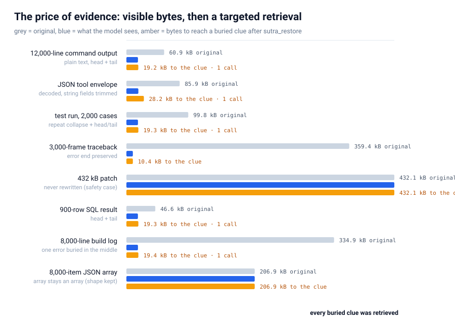

# SUTRA

**Less output. More signal.**

Your agent does not need the whole 2 MB log. It needs the failing line, the stack frame, the row that matters — and a way back to everything else.

SUTRA is a [Hermes Agent](https://hermes-agent.nousresearch.com) plugin that cuts tool output before the model reads it. It removes bytes, labels exactly what it removed, and keeps the original in a bounded local store, a `sutra_restore` call away.

> **54.3%** fewer bytes · **55.2%** fewer o200k tokens · **8/8** planted clues recovered · **0** diffs touched
>
> Eight generated tool-output shapes. The token column is `tiktoken o200k_base` on the payload text, not a provider bill. [Method and limits](#proof-not-a-promise).

[Install](#install) · [Proof](#proof-not-a-promise) · [How it works](#how-it-works) · [What we don't claim](#what-we-dont-claim)

## Why tool output

A tool result is read once, then re-sent on every following turn of the task. A 2 MB log is not a 2 MB problem; it is 2 MB times the rest of the session.

Measured on one seven-agent Hermes fleet over two days:

```
input tokens          16,330,829
output tokens          3,258,687
cache-read tokens    486,503,074     ← 96.8% of all tokens
```

Nearly every token was context being re-read on the next turn. Compressing the model's *replies* attacks the 3.2M. Compressing *tool output* attacks the 486M. This plugin does the second one — and keeps the original, because a compressor that cannot be questioned is a compressor you cannot trust.

## Install

```bash
git clone https://github.com/g0GobliN/sutra ~/.hermes/plugins/sutra
hermes plugins enable sutra
hermes tools        # enable the SUTRA plugin toolset
```

Compression does not depend on the toolset. The recovery tool is gated by toolset like any other Hermes tool: if you skip `hermes tools`, the marker's `sutra_restore` call fails and the model falls back to re-running the tool. The marker says so.

Confirm what loaded:

```bash
hermes plugins show sutra       # → Status: enabled, version 0.2.0
hermes plugins validate ~/.hermes/plugins/sutra
```

Current release: [v0.2.0](https://github.com/g0GobliN/sutra/releases/tag/v0.2.0). Verified against Hermes Agent `v0.22.2+3030.g4d04303`.

## How it works


The tool executes normally. SUTRA sees the result, applies one ordered set of rules, and hands the model a smaller result with a receipt.

| Rule | Applies to | Effect |
|---|---|---|
| ANSI strip | any result | removes colour/control escapes |
| Repeat collapse | runs of identical lines | keeps 2, replaces the rest with `[sutra: N identical line(s) omitted · id=…]` |
| Head+tail elision | plain text results over `SUTRA_MAX_BYTES` | keeps the start and the end, inserts an explicit marker with the byte count, the id, and the exact offsets |
| JSON field elision | a payload that *is* a JSON document | decodes it, runs the same rules on its string fields, re-encodes — never byte-sliced, never reshaped |
| Traceback preservation | a payload containing a traceback | keeps the error end and elides only the middle |
| Diff protection | diffs and patches | returned **byte-identical**, always |

Two things it deliberately does **not** do:

- **It does not restructure JSON.** A JSON array stays an array; an object keeps its keys. The old opt-in array elision (`SUTRA_JSON_ITEMS`) returned an object where an array went in, so it has been removed — a truncation marker cannot live inside a list without changing its schema.
- **It does not summarise.** No model calls, no rewriting, no invented content. Only omission, always labelled.

A JSON document is never cut at a byte offset. Byte 12,288 of a serialized document can land inside an escape (`\n`, `\u00e9`), and the result stops parsing — `json.loads` raises `Invalid control character at line 1 column 12289`, which is a lost tool call, not a saved token. Documents are decoded, their string fields compressed and the document re-encoded; if a document has nothing worth eliding it is returned untouched, and if the re-encoded text somehow fails to parse, the original is returned.

Anything that is not a string or a dict, any parse error, and any internal exception returns the original object untouched. The plugin fails open by design.

## Proof, not a promise


The eight payloads are generated in `bench/benchmark.py`, each with one clue planted where the model would not see it after compression (the two protected cases keep theirs visible). Bytes are measured on the payload text; tokens are counted on the same text with `tiktoken`'s `o200k_base` encoding.

| payload | rule | bytes before → after | o200k tokens before → after | saved |
|---|---|---:|---:|---:|
| 12,000-line command output | `head-tail` | 60.9 kB → 18.6 kB | 35,000 → 10,149 | 71.0% |
| JSON tool envelope | `json-fields` | 85.9 kB → 19.2 kB | 26,012 → 5,670 | 78.2% |
| test run, 2,000 cases | `head-tail` | 99.8 kB → 18.6 kB | 29,998 → 5,529 | 81.6% |
| 3,000-frame traceback | `traceback` | 359.4 kB → 10.3 kB | 126,015 → 3,680 | 97.1% |
| 600 KB patch | `diff-kept` | 432.1 kB → 432.1 kB | 120,039 → 120,039 | 0.0% |
| 900-row SQL result | `head-tail` | 46.6 kB → 18.5 kB | 18,906 → 7,543 | 60.1% |
| 8,000-line build log | `head-tail` | 334.9 kB → 18.6 kB | 127,005 → 6,905 | 94.6% |
| 8,000-item JSON array | `json-kept` | 206.9 kB → 206.9 kB | 103,002 → 103,002 | 0.0% |
| **total** | | **1.63 MB → 742.7 kB (54.3%)** | **585,977 → 262,517 (55.2%)** | |

The patch row is the one to read twice. A compressor that also shrinks your diffs is a compressor that can hide a code change, so that row saves nothing on purpose. The JSON array row saves nothing because keeping the array an array leaves nothing safe to remove.

The bytes and the tokens agree closely here — but they are different measurements. A byte removed is not automatically a token removed, and neither is a line on your provider's bill. [What we don't claim](#what-we-dont-claim) has the boundary.

### The evidence comes back

Each fixture has a clue planted in the elided middle. The retrieval column is a real `sutra_restore` call against the real store:



| payload | visible | calls | response | total to the clue | clue recovered |
|---|---|---:|---:|---:|---|
| 12,000-line command output | 18.7 kB | 1 | 554 B | 19.2 kB | yes |
| JSON tool envelope | 19.3 kB | 1 | 8.9 kB | 28.2 kB | yes |
| test run, 2,000 cases | 18.6 kB | 1 | 711 B | 19.4 kB | yes |
| 3,000-frame traceback | 10.4 kB | 0 | — | 10.4 kB | yes (error end kept) |
| 600 KB patch | 432.1 kB | 0 | — | 432.1 kB | yes (untouched) |
| 900-row SQL result | 18.6 kB | 1 | 716 B | 19.3 kB | yes |
| 8,000-line build log | 18.7 kB | 1 | 712 B | 19.4 kB | yes |
| 8,000-item JSON array | 206.9 kB | 0 | — | 206.9 kB | yes (untouched) |

Five cases needed one call; three were already visible. The JSON envelope pays the most (8.9 kB) because its whole payload is one 86 kB line and the search has to return a clipped window around the match; everything with normal line breaks costs about 700 bytes.

### What it costs to run

| payload | compress | compress + store |
|---|---:|---:|
| 12,000-line command output | 11.4 ms | 24.0 ms |
| JSON tool envelope | 13.4 ms | 27.6 ms |
| test run, 2,000 cases | 6.6 ms | 15.3 ms |
| 3,000-frame traceback | 21.3 ms | 44.5 ms |
| 600 KB patch | 0.3 ms | not rewritten |
| 900-row SQL result | 3.5 ms | 9.1 ms |
| 8,000-line build log | 41.3 ms | 43.2 ms |
| 8,000-item JSON array | 39.1 ms | not rewritten |

One warm run on the development machine; a busy machine can double these, so read them as scale, not a portable performance claim. Peak *additional* heap while rewriting the 359 kB traceback: 701 KiB (tracemalloc, excluding the input string itself). A retained rewrite costs a second compression pass — that is the main cost of keeping the original, and it is still a small fraction of a model turn.

**No live model was called to produce the compression or retrieval numbers in this repository.** See [docs/benchmark.md](docs/benchmark.md) for the method and the release gate.

Reproduce the tables — the payloads are generated, the compressor and store are the real plugin, nothing touches the network:

```bash
python3 bench/benchmark.py                  # bytes, recovery, overhead; writes the charts
python3 -m pip install -r bench/requirements.txt
python3 bench/tokens.py                     # o200k token counts for the same fixtures
python3 bench/retrieval.py                  # worst-case restore at the 32 MiB cap
```

Savings on your own machine, from the plugin's own log:

```bash
python3 - <<'PY'
import json, pathlib
p = pathlib.Path.home() / ".hermes/cache/sutra-stats.jsonl"
rows = [json.loads(l) for l in p.read_text().splitlines() if l.strip()]
changed = [r for r in rows if r.get("changed", True)]  # older logs have rewrites only
before = sum(r["original_bytes"] for r in changed)
after = sum(r["compressed_bytes"] for r in changed)
stored = sum(1 for r in changed if r.get("stored"))
print(f"{len(changed)} rewrites, {before:,} → {after:,} bytes ({1 - after / before:.1%} saved), {stored} recoverable")
PY
```

The honest test is a before/after on your own workload: run the same task with the plugin disabled and enabled and compare `input_tokens` in the session row.

## The marker is the contract

An elided top-level result looks like this (one line, wrapping here for width):

```
… [sutra: partial · 133,522 bytes elided (large output) · id=su_3e72c41e… ·
   original 151,920 B retained 168h ·
   retrieve: sutra_restore(id="su_3e72c41e…", mode="bytes", start=12259, end=145781)] …
```

It answers, in order: is this complete (no — `partial`), what is missing and why, is the original still available (yes, with a retention window), and exactly how to get it. When the elision happens inside a JSON string field the marker names the field and its offsets are relative to that field:

```
[sutra: partial · 40,470 bytes elided (large output) · field="/output" · id=su_… ·
 original 85,921 B retained 168h ·
 retrieve: sutra_restore(id="su_…", field="/output", mode="bytes", start=12280, end=52750)]
```

If storage is off, full, or the write failed, the marker says so instead — it never claims an id for bytes that were not kept:

```
[sutra: partial · 45,231 bytes elided (large output) · original not retained ·
 re-run the tool with a narrower query (grep/head/offset) to see the middle]
```

Repeat collapse has its own marker. It names the first omitted line and the omitted line range in the retained original (`end` is exclusive), so the call can be followed verbatim:

```
[sutra: 4,998 identical line(s) omitted · id=su_… ·
 retrieve: sutra_restore(id="su_…", mode="lines", start=3, end=5001)]
```

Inside a JSON field the same marker carries `field="/log"` and its line numbers are relative to that field. Line numbers count the retained original, not the rewritten copy; `mode=lines` pages with `next` like `mode=bytes` does. If a result's line breaks cannot be addressed consistently, the marker says so and quotes no call rather than one that would return nothing.


## Recovery

`sutra_restore` is a normal Hermes tool registered by this plugin (toolset `sutra`):

| Argument | Meaning |
|---|---|
| `id` | the id from the marker |
| `mode` | `bytes` (exact offsets), `lines` (1-based, end exclusive), `search` (literal text with context), `full` (whole original when it fits) |
| `field` | optional JSON pointer (`/output`, `/items/3/log`) to scope the request to one string field |
| `start` / `end` | range for `bytes` or `lines`; `end` is exclusive |
| `query` / `context` / `case_sensitive` | literal search, never a regex |
| `max_matches` / `max_bytes` | hard caps; `max_bytes` defaults to 8 KiB and never exceeds 64 KiB |

The response is JSON with an explicit `status` — `ok`, `not_found`, `expired`, `too_large`, `unavailable`, `error` — the range or query it served, `complete` (was the request satisfied), `more` (does evidence remain), a `content_note` marking the text as untrusted data, and for `mode=full` a `sha256_verified` flag. That flag is the store's own verify check against the digest recorded when the original was stored. Paging is exact: concatenating the `content` of successive `mode=bytes` pages reproduces the original slice byte for byte.

Full protocol: [docs/recovery.md](docs/recovery.md).

## Safety contract

1. **It only removes.** No summarising, no rewriting, no invented content.
2. **It always says what it removed** — byte counts and item counts, in a marker the model can read.
3. **It tells the model how to recover** the elided part, by id and byte offset or line range, or by re-running the tool narrower.
4. **It never touches diffs**, and never drops the tail of a traceback.
5. **It never breaks a payload's own format.** JSON in, same-shaped valid JSON out.
6. **It only cites bytes it actually kept.** No id, no promise.
7. **It is measurable**: every rewrite appends a record to a local JSONL file, and every retained original is a file with a hash.
8. **It fails open.** Any unexpected shape returns the original result.

## Configuration

Environment variables, read on every call:

| Variable | Default | Meaning |
|---|---|---|
| `SUTRA_ENABLED` | `1` | `0` disables compression entirely (and retention) |
| `SUTRA_MAX_BYTES` | `24576` | results at or below this are untouched; larger results are rewritten to fit it |
| `SUTRA_HEAD_BYTES` | `12288` | bytes kept from the start |
| `SUTRA_TAIL_BYTES` | `6144` | bytes kept from the end (scaled down proportionally if head+tail exceed the cap) |
| `SUTRA_STATS_FILE` | `$HERMES_HOME/cache/sutra-stats.jsonl` | where savings are recorded |
| `SUTRA_STATS_MAX_BYTES` | `5242880` | rotate the log at this size (keeps one `.1`) |
| `SUTRA_STORE` | `1` | `0` stops retaining originals; markers then say "not retained" |
| `SUTRA_STORE_DIR` | `$HERMES_HOME/cache/sutra-store` | where originals live |
| `SUTRA_STORE_TTL_HOURS` | `168` | how long an original is kept |
| `SUTRA_STORE_MAX_BYTES` | `134217728` | total size of the store (128 MiB) |
| `SUTRA_STORE_MAX_ENTRY_BYTES` | `33554432` | largest single original retained (32 MiB) |
| `SUTRA_STORE_MAX_ENTRIES` | `2000` | most originals retained |
| `SUTRA_RECOVERY_MAX_BYTES` | `8192` | default response cap for `sutra_restore` (hard max 64 KiB) |
| `SUTRA_RECOVERY_MAX_MATCHES` | `5` | default matching lines per search (hard max 20) |
| `SUTRA_JSON_ITEMS` | retired | ignored; warning logged if set |

One module parses all of these, once per call: `sutra.configuration()` returns the resolved values (engine budgets, store limits, retrieval caps, stats path, enabled flag) as a frozen object with `as_dict()`, so an operator or a test can see exactly what every component is using.

Defaults are a disk commitment, not just a tuning knob: up to 128 MiB of tool output per profile, for seven days. Set `SUTRA_STORE=0` if that is not acceptable; compression keeps working, recovery does not.

## Operating it

`sutra.metrics_snapshot()` is the one read surface for component 6: compression decisions, restore outcomes, cleanup, and the store's current size. It is explicitly **process-scoped** — the response says `scope: "process"` and carries a note, because its counters reset when the plugin host restarts. The JSONL stats log is durable, but holds rewrites only; it is not a substitute for the current-process counters.

```python
>>> sutra.metrics_snapshot()
{"scope": "process",
 "scope_note": "Counters cover this Hermes plugin-host process only; they reset on restart. The JSONL stats log is durable and retains rewritten results only.",
 "restores": {"total": 6, "ok": 1, "bad_id": 1, "expired": 1, "not_found": 1,
              "range": 1, "unavailable": 1},
 "cleanup": {"runs": 3, "entries": 3, "bytes": 1_211, "expired": 2, "quota": 1,
             "orphans": 0, "temp": 0},
 "compression": {"total": 8, "changed": 5, "unchanged": 3,
                 "rules": {"head-tail": 2, "json-fields": 2, "none": 3, "fail-open": 1},
                 "original_bytes": 31_940, "compressed_bytes": 12_480,
                 "saved_bytes": 19_460, "omitted_bytes": 20_001, "partial": 5,
                 "stored": 5, "fail_open": 1, "duration_ms_total": 41.7},
 "store": {"entries": 1, "bytes": 1_300, "enabled": True}}
```

`compression` counts every decision, changed or not: `total`, `changed`, `unchanged`, per-rule `rules`, bytes before (`original_bytes`) and after (`compressed_bytes`), `saved_bytes`, `omitted_bytes`, `partial`, `stored` (retained), `fail_open`, and the summed processing time. Only rewrites append to the stats log; its `changed` flag is true for every new row, and older rows lack the field. Unchanged decisions stay in the counters. The log is rotated at `SUTRA_STATS_MAX_BYTES`. `restores` counts every outcome by reason; `cleanup.runs` is one entry per cleanup that removed something, split into `expired`, `quota`, `orphans` and `temp`, with the bytes those removals reclaimed. Cleanup also logs one line per run (`sutra: cleanup removed …`). The counters are in-memory and per process; recording one is best-effort and can never fail a restore or a compression. After a restart, `compression.total` is zero even though the log has older rewrite rows — that difference is the contract, stated in the snapshot itself.

## Storage and privacy

Originals are written to `$HERMES_HOME/cache/sutra-store/`, one file plus one metadata file per entry:

- directory `0700`, files `0600`, opened `O_NOFOLLOW`; a symlinked store directory is refused;
- ids are 128-bit random and validated against `^su_[0-9a-f]{32}$` before any path is built;
- atomic writes (temp file + rename), so an interrupted write is never served as a complete entry;
- bounded by per-entry size, total size, entry count and TTL: the quota and count are checked on every write from in-process accounting, and a full oldest-first sweep runs only when a budget is exceeded, every 128 writes, or every ten minutes, plus one seeding sweep per process (expired entries are refused on read);
- the metadata file holds sizes, a SHA-256, a timestamp, the tool name and the session id — never the payload;
- the stats file holds counts and durations, never content.

Tool output can contain secrets. The store is local, per-profile and expiring, but it is not encrypted and any process running as you can read it. Full model and reporting guidance: [SECURITY.md](SECURITY.md).

## What we don't claim

- **No live-model A/B.** No provider was called, no input/output/cache token row was measured, no cost was computed, and no task success rate was scored. Those need a model endpoint, a task set and a budget — see [docs/benchmark.md](docs/benchmark.md).
- **The token column is a tokenizer count, not a bill.** `tiktoken o200k_base` on the payload text. Another model's tokenizer will produce different counts, prompt caching changes what is re-sent, and the host may truncate tool results on its own. Do not read 55.2% as "55.2% off your invoice".
- **8/8 is retrievability, not task success.** It proves the clue is in the store and `sutra_restore` returns it. It does not prove an agent will think to ask.
- **The fixtures are generated.** They are representative in shape, not in the distribution of your tool output.
- **The timings are one machine.** They are scale, not a portability claim.
- **The patch and array rows save 0% on purpose.** One protects a code change; the other protects a JSON shape.

## Known limitations

- **The toolset must be enabled** before the model can call `sutra_restore`; the marker then degrades to "re-run narrower".
- **JSON re-encoding normalises the document**: indentation and whitespace inside the payload are not preserved, and duplicate keys collapse to the last value. The original bytes remain in the store, so nothing is lost, but the visible copy is not byte-identical to what the tool printed.
- **Large JSON arrays with no large string fields are not compressed at all** — that is the price of not changing their shape.
- **A JSON field whose pointer cannot be quoted is left uncompressed**: pointers are capped at 256 UTF-8 bytes, and a key containing a quote, backslash, newline, `]` or `)` would make the marker ambiguous. Such a field is returned whole, with no omission marker claiming it.
- **Retrieval is bounded**: one entry ≤32 MiB, one response ≤64 KiB, at most 20 matches, literal search; `full` refuses above the cap and a single line longer than the response cap is returned clipped. The measured worst case at the 32 MiB cap is 355 ms (median 329 ms) on the development machine; see [docs/recovery.md](docs/recovery.md#execution-time-envelope).
- **One extra compression pass** when the original is retained.
- **`plugins.isolation: host`**: the middleware runs in Hermes's plugin host process, so each rewrite crosses that boundary.
- **No live-model benchmark** ships here. Token, cost and task-success numbers beyond the tokenizer column require a model and a task harness this environment does not have.

## Troubleshooting

| Symptom | Likely cause | What to do |
|---|---|---|
| `status: expired` | TTL or quota cleanup removed the original | re-run the tool narrowly; raise `SUTRA_STORE_TTL_HOURS` before the fact |
| `status: too_large` | the scope is above the 8 KiB response cap | ask for `mode="bytes"` or `mode="lines"` with a range, or a literal `search`; `max_bytes` may rise to 65,536 |
| `status: unavailable` | `SUTRA_STORE=0`, or the store path is not a plain directory | re-enable the store; use a normal directory for `SUTRA_STORE_DIR` |
| `status: not_found` | wrong, expired or pruned id, or a corrupt entry deleted on lookup | re-run the tool; do not invent ids |
| `status: error` | malformed field pointer, range, or query | read `error`; fix the argument |
| marker has no id | not retained: store off, over quota, entry too large, or write failed | re-run narrower; check `SUTRA_STORE*` |
| `sutra_restore` unknown / no tool | toolset `sutra` is disabled for the platform | enable the toolset in Hermes |
| plugin not loaded, or old code runs | disabled, not installed, or a stale copy shadows the checkout | `hermes plugins list`, `hermes plugins show sutra`, `hermes plugins validate .`; remove the stale `plugins/sutra` copy |
| store keeps growing | TTL/quota are larger than expected | inspect `sutra.metrics_snapshot()`; lower `SUTRA_STORE_TTL_HOURS`, `SUTRA_STORE_MAX_BYTES`, `SUTRA_STORE_MAX_ENTRIES` |

`plugins.isolation: host` means the middleware runs in Hermes's plugin host process; a stale installed copy can win over a checkout you are editing. That is the first thing to check when a change does not appear.

## Removing it

If Hermes installed it:

```bash
hermes plugins disable sutra
hermes plugins remove sutra
```

`remove` takes the plugin directory name shown by `hermes plugins list`. If the plugin was copied or symlinked into place instead, delete that directory — `$HERMES_HOME/plugins/sutra` (usually `~/.hermes/plugins/sutra`), or `./.hermes/plugins/sutra` for a project-local install — and restart Hermes.

Removal does not delete retained output or its log. To remove those as well:

```bash
rm -rf "$HERMES_HOME/cache/sutra-store" "$HERMES_HOME"/cache/sutra-stats.jsonl*
```

This permanently deletes every retained original; back up anything you need first.

## Development

```bash
python3 -m venv .venv && .venv/bin/pip install pytest
.venv/bin/python -m pytest -q                 # 147 tests, no Hermes runtime needed
.venv/bin/python bench/benchmark.py           # compression + clue recovery
.venv/bin/python bench/retrieval.py           # worst-case restore at the 32 MiB cap
hermes plugins validate .                     # loads the plugin the way Hermes does
```

The tokenizer table adds one optional dependency:

```bash
.venv/bin/pip install -r bench/requirements.txt
.venv/bin/python bench/tokens.py
```

The tests cover every rule, both never-touch payloads, the fail-open paths, text fidelity (CRLF, final newline, UTF-8 boundaries), configuration, metrics, the store (TTL, quota, permissions, symlinks, concurrency, interrupted writes), the retrieval protocol (statuses, bounds, pagination, field scope, the 32 MiB cap), the Hermes middleware-chain contract, and the benchmark's own claims.

CI runs the suite on Python 3.10–3.13, `ruff check .`, `hermes plugins validate .` against the pinned Hermes revision, and a tag/version consistency check on `v*` tags.

## Compatibility

Verified against **Hermes Agent v0.22.2+3030.g4d04303 (2026.9.24)** with
`hermes plugins validate .` (host Python 3.14.7). The test suite and the
benchmarks run on Python 3.13.5 in `.venv`. Newer Hermes versions are not
claimed; the middleware contract has its own test so a mismatch should fail
there before it reaches a model.

## Contributing

See [CONTRIBUTING.md](CONTRIBUTING.md). Bug reports with a reproducible result shape are the most useful contribution; a rule that removes more than it should is a security-grade bug, not a tuning issue.

If SUTRA saves you a retry, star the repo. If it hides a byte it shouldn't, open an issue.

## Licence

MIT.
